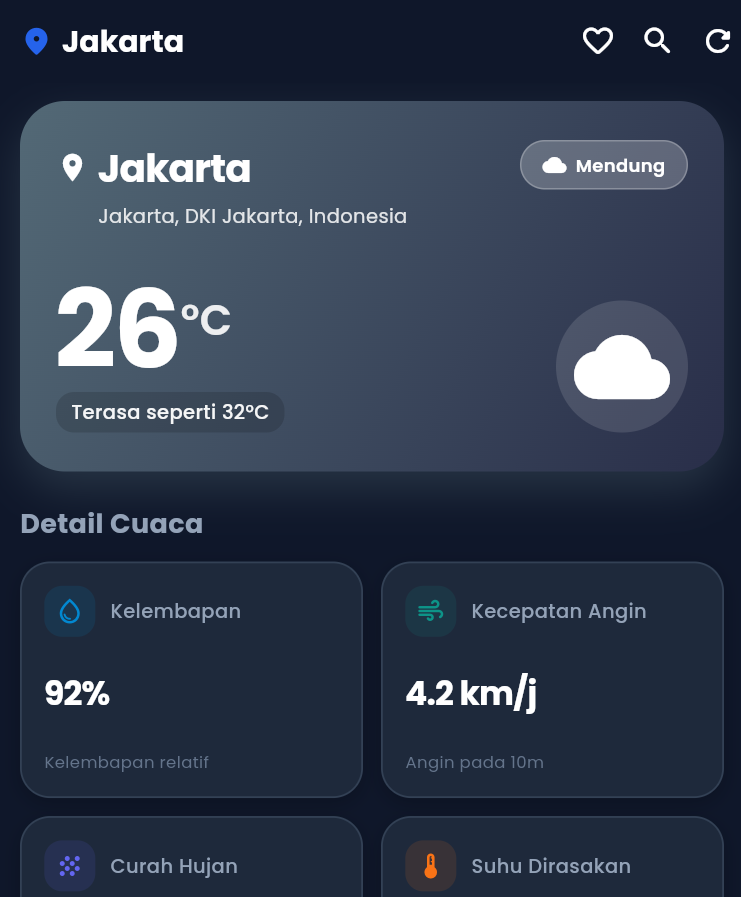

# Responsi Weather App

Aplikasi ramalan cuaca modern berbasis Flutter yang mengimplementasikan arsitektur **Model-View-ViewModel (MVVM)**, integrasi **REST API Open-Meteo** secara real-time, penyimpanan lokal **SharedPreferences**, serta desain antarmuka **Material 3** dengan tipografi **Poppins**.

---

## Identitas Mahasiswa

| Atribut | Keterangan |
| :--- | :--- |
| **Nama** | Rinaldi DB |
| **NIM** | H1D024065 |
| **Mata Kuliah** | Praktikum Pemrograman Mobile |
| **Shift** | Shift G |

---

## Video Penjelasan Aplikasi

Penjelasan lengkap mengenai struktur proyek, integrasi API, arsitektur MVVM, dan bedah kode program dapat disaksikan pada video berikut:

**Link Video YouTube:** [https://youtu.be/JPGNEXtAZoc](https://youtu.be/JPGNEXtAZoc)

---

## Tangkapan Layar (Screenshots)

Berikut adalah antarmuka aplikasi cuaca yang dapat ditemukan pada direktori `assets/sikirinsut/`:

| Layar Utama Cuaca | Layar Pencarian & Riwayat | Tampilan Lokasi Terpilih |
| :---: | :---: | :---: |
|  |  |  |

---

## Fitur-Fitur Aplikasi

1. **Informasi Cuaca Terkini (Real-Time Weather)**
   - Menampilkan nama kota dan wilayah yang sedang aktif.
   - Menampilkan kondisi cuaca terkini dengan ikon dan deskripsi bahasa Indonesia (Cerah, Berawan, Hujan, Badai Petir, dll.).
   - Suhu saat ini (`current.temperature_2m`).
   - Suhu yang dirasakan tubuh / Apparent Temperature (`current.apparent_temperature`).
   - Kartu cuaca utama dengan warna gradien dinamis yang menyesuaikan kondisi cuaca.

2. **Detail Metrik Cuaca Lengkap**
   - **Kelembapan Udara** (`current.relative_humidity_2m` dalam %).
   - **Kecepatan Angin** (`current.wind_speed_10m` dalam km/jam).
   - **Curah Hujan** (`current.precipitation` dalam mm).
   - **Suhu yang Dirasakan** (`current.apparent_temperature` dalam derajat Celsius).

3. **Perkiraan Cuaca Harian (Daily Forecast)**
   - Menampilkan ramalan cuaca untuk beberapa hari ke depan.
   - Informasi suhu maksimum harian (`daily.temperature_2m_max`) dan minimum harian (`daily.temperature_2m_min`).
   - Informasi persentase peluang hujan maksimum harian (`daily.precipitation_probability_max`).
   - Format tanggal lokal bahasa Indonesia (*Hari ini*, *Besok*, *Nama Hari & Tanggal*).

4. **Pencarian Lokasi Berdasarkan Nama Kota**
   - Menggunakan Open-Meteo Geocoding API secara dinamis.
   - Menampilkan hasil pencarian lengkap dengan nama kota, provinsi/wilayah administratif, negara, dan koordinat lintang/bujur.
   - Memilih kota dari hasil pencarian langsung memperbarui data cuaca kota tersebut secara real-time.

5. **Penyimpanan Lokal (Local Storage via SharedPreferences)**
   - **Lokasi Favorit**: Menyimpan kota-kota pilihan ke dalam daftar favorit dengan satu klik pada tombol hati/love.
   - **Riwayat Pencarian**: Menyimpan kata kunci pencarian terakhir yang dapat diklik kembali untuk mencari ulang atau dihapus per item maupun sekaligus.
   - **Lokasi Terakhir**: Aplikasi otomatis mengingat lokasi terakhir yang dibuka pengguna saat aplikasi ditutup dan dibuka kembali.

6. **Interaktivitas & Penanganan Kondisi (State Handling)**
   - **Pull-to-Refresh**: Memperbarui data cuaca terkini langsung dari server dengan menarik layar ke bawah.
   - **Loading State**: Animasi indikator pemuatan saat data sedang diambil.
   - **Error State**: Tampilan pesan galat yang informatif saat koneksi internet terputus atau API bermasalah, dilengkapi tombol **Coba Lagi** (*Retry*).

---

## Pola Arsitektur (MVVM Architecture)

Aplikasi ini menggunakan pola arsitektur **Model-View-ViewModel (MVVM)** dengan state management **Provider**:

```text
┌─────────────────┐        User Action        ┌─────────────────┐
│                 │ ────────────────────────> │                 │
│      VIEW       │                           │    VIEWMODEL    │
│ (Screen/Widget) │ <──────────────────────── │ (ChangeNotifier)│
└─────────────────┘      notifyListeners()    └─────────────────┘
                                                       │        ▲
                                          fetch/update │        │ data
                                                       ▼        │
                                              ┌─────────────────┐
                                              │ SERVICE & MODEL │
                                              │  (API & Storage)│
                                              └─────────────────┘
```

- **Model (`lib/models/`)**: Merepresentasikan struktur data murni dan parsing JSON (`LocationModel`, `WeatherModel`, `CurrentWeather`, `DailyForecastItem`).
- **Service (`lib/services/`)**: Mengelola panggilan REST API Open-Meteo (`ApiService`) dan operasi persistensi SharedPreferences (`StorageService`).
- **ViewModel (`lib/viewmodels/`)**: Mengelola logika bisnis, menangani state (`isLoading`, `errorMessage`, `weather`), dan memanggil `notifyListeners()` untuk memperbarui View secara reaktif (`WeatherViewModel`, `SearchViewModel`).
- **View (`lib/views/`)**: Lapisan antarmuka pengguna (`WeatherScreen`, `SearchScreen`, serta widget modular) yang mengonsumsi data dari ViewModel menggunakan `Consumer`.

### Struktur Folder Proyek
```text
lib/
├── main.dart
├── models/
│   ├── location_model.dart
│   └── weather_model.dart
├── services/
│   ├── api_service.dart
│   └── storage_service.dart
├── viewmodels/
│   ├── weather_viewmodel.dart
│   └── search_viewmodel.dart
├── utils/
│   ├── theme.dart
│   └── weather_code_helper.dart
└── views/
    ├── home/
    │   └── weather_screen.dart
    ├── search/
    │   └── search_screen.dart
    └── widgets/
        ├── current_weather_card.dart
        ├── daily_forecast_list.dart
        ├── error_state_view.dart
        ├── loading_state_view.dart
        └── weather_detail_grid.dart
```

---

## Endpoint API yang Digunakan

Aplikasi terhubung ke **Open-Meteo API** tanpa memerlukan API Key:

1. **Weather Forecast API**:
   ```http
   GET https://api.open-meteo.com/v1/forecast?latitude={lat}&longitude={lon}&current=temperature_2m,relative_humidity_2m,apparent_temperature,precipitation,weather_code,wind_speed_10m&daily=weather_code,temperature_2m_max,temperature_2m_min,precipitation_probability_max&timezone=auto
   ```
2. **Geocoding API**:
   ```http
   GET https://geocoding-api.open-meteo.com/v1/search?name={query}&count=10&language=id&format=json
   ```

---

## Cara Menjalankan Aplikasi

### 1. Prasyarat
- Pastikan telah menginstal **Flutter SDK** (versi 3.16 atau yang lebih baru).
- Pastikan telah menginstal **Dart SDK**.
- Emulator Android / iOS atau perangkat fisik dengan fitur *USB Debugging* aktif.

### 2. Langkah Instalasi & Menjalankan

1. **Buka folder proyek** di terminal atau editor (Android Studio / VS Code):
   ```bash
   cd responsi_weather
   ```

2. **Unduh semua dependensi package**:
   ```bash
   flutter pub get
   ```

3. **Jalankan pengujian unit & integrasi** *(opsional)*:
   ```bash
   flutter test
   ```

4. **Jalankan aplikasi**:
   ```bash
   flutter run
   ```
   *(Pilih perangkat atau emulator target yang tersedia)*.
